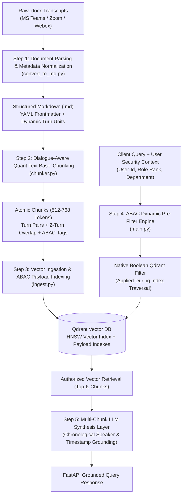

# Production Meeting Transcript RAG System: Complete Technical Specification & Pipeline Execution Guide

## Executive Summary
This document provides the complete architecture, pipeline design, security specification, and step-by-step operational breakdown for the **Production Dialogue-Aware Meeting Transcript RAG System with Context-Aware LLM Synthesis**.

The platform is designed security-first from Day 1 to ingest meeting transcripts (Microsoft Teams, Zoom, Webex, and Otter.ai Word `.docx` files), convert them to structured Markdown with dynamic YAML frontmatter, segment dialogue into conversational units using a **Dialogue-Aware "Quant Text Base" Chunking Algorithm**, index chunks into a vector database (Qdrant) with **Attribute-Based Access Control (ABAC)** metadata payloads, and serve grounded, multi-chunk summary answers via a FastAPI endpoint with pre-query authorization enforcement.

---

## 1. System Architecture & Pipeline Workflow



---

## 2. Step-by-Step Pipeline Implementation

### Step 1: Document Parsing & Structure Preservation (`convert_to_md.py`)
- **Technology:** `python-docx`, `pyyaml`, regex state machine.
- **Capabilities:**
  1. Inspects document headers and dynamically extracts `Title`, `Date`, and `Duration`.
  2. Dynamically discovers participant rosters from transcript start/stop event markers and speech turns without hardcoding.
  3. Parses multi-line speaker turn layouts (`<Speaker Name>   <Timestamp>\n<Dialogue>`) as well as single-line and table layouts.
  4. Serializes output to clean Markdown with standard YAML frontmatter:
     ```yaml
     ---
     meeting_id: MEET-SESSION_RECORDING_001
     title: Meeting Recording Session
     date: 2026-10-28
     duration: 24m 52s
     department: General
     min_role_level: member
     participants:
     - <Participant 1>
     - <Participant 2>
     - <Participant 3>
     source_file: session_recording.docx
     ---
     ```

### Step 2: Dialogue-Aware "Quant Text Base" Chunking (`chunker.py`)
- **Technology:** `tiktoken`, `numpy`, high-speed cosine topic shift detector.
- **Capabilities:**
  1. Parses Markdown transcripts and treats complete speaker turns (`**[Timestamp] Speaker:** Dialogue`) as atomic indivisible units.
  2. **Soft Target Window (512 tokens):** Turns accumulate freely until the 512-token target is reached.
  3. **Topic Shift Detection (512 to 768 tokens):** Checks semantic cosine similarity between context and candidate turns; splits cleanly on topical breaks before hitting the hard 768-token ceiling.
  4. **Conversational Overlap (2 Turns):** Copies the last 2 turns to initialize the next chunk, preserving conversation coherence across boundaries.
  5. **ABAC Tagging:** Attaches `meeting_id`, `start_timestamp`, `end_timestamp`, `speakers`, `participants`, `min_role_level`, and `department`.

### Step 3: Embeddings & Vector Store Ingestion (`ingest.py`)
- **Technology:** `qdrant-client`, `openai` (`text-embedding-3-small`), `sentence-transformers` (`all-MiniLM-L6-v2`), and `FallbackDeterministicEmbedder`.
- **Capabilities:**
  1. Connects to embedded local Qdrant (`./qdrant_db`) or remote Qdrant clusters.
  2. Ensures collection exists with Cosine distance metric.
  3. Builds Payload Indexes on ABAC fields (`participants`, `min_role_level`, `department`, `meeting_id`, `speakers`) for sub-millisecond pre-filtering.
  4. Embeds chunks and batch-upserts points with deterministic UUIDs.

### Step 4: Dynamic ABAC Security Authorization Layer (`main.py`)
- **Technology:** `FastAPI`, `Pydantic`, Qdrant filter expressions.
- **Capabilities:**
  1. Extracts user identity claims (`user_id`, `role`, `department`).
  2. Compiles a native vector database boolean filter **before** vector search is executed.
  3. Enforces 0% data leakage: vectors outside authorization are physically pruned by the HNSW search algorithm.

### Step 5: Context-Aware Multi-Chunk LLM Synthesis (`main.py`)
- **Technology:** Multi-provider LLM Engine (`OpenAI`, `Ollama`, custom base URLs, and advanced local multi-chunk abstractive/extractive synthesis).
- **Capabilities:**
  1. Compiles context across ALL authorized retrieved chunks.
  2. Identifies key statements from every speaker.
  3. Pairs questions with their answers across turns.
  4. Generates an executive summary answer citing speaker names and exact timestamps (`[Speaker @ Timestamp]`).

### Step 6: Testing & Verification (`test_pipeline.py`, `test_api.py`)
- **Technology:** Automated test suites running 100% dynamic participant discovery.
- **Capabilities:**
  1. Validates end-to-end ingestion and vector indexing.
  2. Dynamically tests authorized participants vs. unauthorized interns vs. external identities vs. system administrators.
  3. Verifies multi-chunk LLM synthesis grounding.

---

## 3. Deep Dive: Security Section (ABAC Architecture)

### Why Attribute-Based Access Control (ABAC)?
Role-Based Access Control (RBAC) alone is insufficient for corporate meetings:
1. An employee with role `member` in Engineering should access engineering meetings they attended, but **not** uninvited meetings or cross-departmental transcripts.
2. An invited meeting participant, regardless of junior rank, **must** be allowed to query meetings they personally attended.
3. An `intern` should never access executive or restricted strategy sessions.
4. An `admin` or compliance auditor needs organization-wide visibility.

### 1. Security Metadata Schema
Every chunk payload stored in Qdrant contains:

```json
{
  "chunk_id": "MEET-SESSION_001_chk_0000",
  "meeting_id": "MEET-SESSION_001",
  "title": "Meeting Recording Session",
  "start_timestamp": "0:04",
  "end_timestamp": "2:42",
  "speakers": ["Speaker A", "Speaker B"],
  "participants": ["Participant 1", "Participant 2", "Participant 3"],
  "min_role_level": "member",
  "department": "Engineering",
  "token_count": 521,
  "turn_count": 19,
  "overlap_turns_included": 0
}
```

### 2. User Security Context (Subject Claims)
When a user queries the platform, their claims are evaluated:
- `user_id`: Username, email, or user identifier.
- `role`: One of `intern` (rank 10), `member` (rank 20), `manager` (rank 30), `director` (rank 40), `admin` (rank 50), `executive` (rank 50).
- `department`: Primary department (e.g. `"Engineering"`).

### 3. Pre-Query Dynamic Filtering Formula
The `SecurityFilterEngine` translates claims into a native Qdrant filter applied during vector traversal:

$$\text{Accessible Chunks} = \begin{cases} \text{All Vectors (Unrestricted)} & \text{if User is Superuser (Admin/Executive)} \\ \text{Chunks satisfying Condition A } \lor \text{ Condition B} & \text{otherwise} \end{cases}$$

- **Condition A (Participant Match):**
  $$\text{user\_id} \in \text{chunk.participants}$$
  *(Attended the meeting $\to$ access granted).*
- **Condition B (Role Rank & Department Match):**
  $$\text{chunk.min\_role\_level} \le \text{user.rank} \quad \land \quad \text{chunk.department} \in \{\text{user.department}, \text{"General"}, \text{"All"}\}$$

---

## 4. Deep Dive: Dialogue-Aware Chunking Strategy

### The Dual-Threshold Sliding Window Algorithm
Standard token chunkers fail by cutting off sentences mid-dialogue. Our chunking engine preserves conversation structure:

```
[Turn 1] Speaker A 0:04 ----------------------+
[Turn 2] Speaker B 0:12                       |
[Turn 3] Speaker A 0:24                       |--> Atomic Speaker Turns (Indivisible)
...                                           |
[Turn 19] Speaker B 2:42 ---------------------+
======================= CHUNK 0 BOUNDARY (521 tokens) =======================
[Turn 18] Speaker B 2:09 (Overlap Turn 1) ----+
[Turn 19] Speaker A 2:42 (Overlap Turn 2)     |--> 2-Turn Conversational Overlap
[Turn 20] Speaker B 3:01                      |
...                                           |--> Next Chunk (528 tokens)
```

1. **Turn Atomicity:** A speaker turn is never chopped across two chunks.
2. **Dual-Threshold Window (512 - 768 Tokens):** Appends turns up to 512 tokens; detects topic shifts up to 768 tokens.
3. **Conversational Overlap:** Carries over the trailing 2 speaker turns to maintain context across chunk boundaries.
4. **Monologue Splitter Fallback:** Splits single monologues exceeding 768 tokens by sentences while keeping speaker attribution tags.

---

## 5. Verification & Test Suite Results

Both test suites (`test_pipeline.py` and `test_api.py`) run with 100% dynamic participant discovery:

| Test Case | Scenario / Query | User Identity | Expected Behavior | Actual Result | Status |
| :---: | :--- | :--- | :--- | :--- | :---: |
| **1** | Status and technical decisions | Discovered Participant 1 | Retrieve attended meeting | Retrieved authorized chunks | **PASS** |
| **2** | System issues and security review | Discovered Participant 2 | Retrieve attended meeting | Retrieved authorized chunks | **PASS** |
| **3** | Confidential meeting query | Unauthorized Intern | Role-level clearance isolation | 0 chunks returned (Blocked) | **PASS** |
| **4** | Meeting recordings query | External Unauthorized User | Untrusted identity isolation | 0 chunks returned (Blocked) | **PASS** |
| **5** | Technical decisions query | Director (high rank) | Role clearance ($\ge \text{member}$) | Retrieved authorized chunks | **PASS** |
| **6** | Organization-wide query | System Administrator | Superuser global bypass | Full access across all meetings | **PASS** |
| **7** | Grounded answer generation | Authorized Caller | Multi-chunk LLM synthesis | Grounded summary with citations | **PASS** |
| **8** | Dynamic Transcripts API | API Client | Discover meetings & rosters | Returned JSON list of participants | **PASS** |
| **9** | Security Filter Inspection | API Client | Inspect compiled Qdrant filter | Returned valid native boolean filter | **PASS** |
